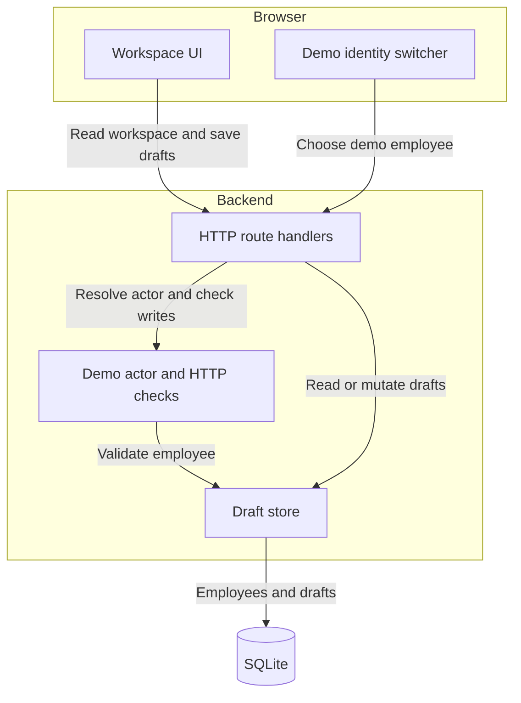

# Architecture · candidate deliverable

Document the solution you actually implement. Keep this concise: two small Mermaid diagrams and a few explanatory paragraphs are enough. Include this work within the three-hour timebox; plan roughly 15–20 minutes for documentation. Unfinished features should be labeled explicitly.

## Example: the existing starter

This example describes the starter **before** the candidate tasks. It demonstrates Mermaid syntax and component boundaries. It does not implement or prescribe the submission, approval, withdrawal, or history design.

The browser uses route handlers rather than accessing SQLite directly. The HTTP helpers resolve the demo cookie (defaulting to Aydan), check the origin of writes, and format errors. The store validates the selected employee and enforces draft ownership. Only employees and drafts are persisted; the candidate designs the request lifecycle and history.

| Example component | Starter location |
| --- | --- |
| Workspace and demo identity switcher | `src/components/workspace.tsx` |
| HTTP route handlers | `src/app/api/` |
| Demo actor and HTTP checks | `src/server/http.ts` |
| Draft store and schema | `src/server/store.ts` |
| Local database | `data/ilenhr.sqlite` by default |

The identity switcher is a local evaluation tool and intentionally allows impersonation. The diagram is not a production authentication architecture.

## 1. Your component diagram

Replace or extend the example to reflect your final implementation. Show the actual UI/backend/data boundaries and the connections between components. Label any proposed but unimplemented components separately.

<!-- Add a fenced mermaid flowchart here. -->

## 2. Your sequence diagram

Use a fenced `mermaid` block beginning with `sequenceDiagram`. Choose submission or manager review. Show who calls whom, where the actor and permissions are checked, what is read/written, the response, and a rejection or conflicting-action path. Use an `alt` block for different outcomes. Mark the transaction boundary where you rely on one.

<!-- Add your sequence diagram here. -->

## 3. Data model and invariants

Describe the entities and relationships you added, the allowed request states/transitions, and how you enforce:

- Ownership, assigned-manager review, and visibility.
- Inclusive date ranges and concurrent overlap prevention.
- One successful transition when actions race.
- State/history consistency and persistence after restart.

Name the real constraints, checks, or transactions you used and link to the relevant code. An ER diagram is welcome if it makes the relationships clearer, but is not required.

## 4. Code map and tradeoff

Map your main diagram components to their real files/functions. Explain one design choice and an alternative you considered. Link to `../DECISIONS.md` rather than repeating a long explanation.

## 5. Future multi-company support

Briefly explain what would change to isolate company data and authorization. This is a discussion only; do not build multi-tenancy for this exercise.

## Before submitting

- Both required Mermaid diagrams render in the GitHub Markdown preview.
- Diagrams agree with your final code and distinguish unfinished or future behavior.
- You can explain one request end to end without relying on an agent's explanation.
